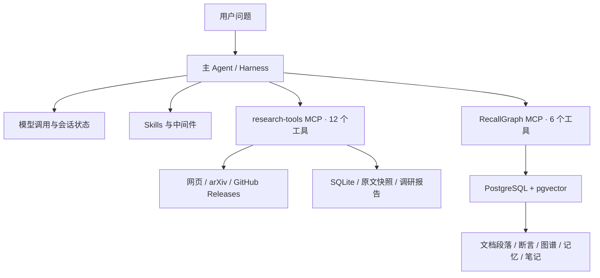

# InsightFlow

**一个面向多源调研与知识分析的 Agent 项目。**


InsightFlow 使用一个主 Agent，根据问题选择在线调研工具或本地知识库工具，完成信息检索、原文核验、证据整理和报告生成。工具能力通过两个独立的 MCP 服务接入，调研记录与知识库各自持久化。

## 核心能力

- **Agent Harness**：基于 LangChain `create_agent` 组织模型与工具循环，管理会话状态、消息和工具执行；通过中间件处理工具异常、缺失工具消息与重复调用。
- **多源调研**：检索网页、arXiv 与 GitHub Releases，固定调研时间窗口，保存原文快照，校验引用并生成 Markdown 报告。
- **知识检索**：结合 BM25 与向量召回，通过加权 RRF 融合结果，支持图谱探索和按段落、文档页码读取原文。
- **记忆与笔记**：召回历史偏好和判断，生成记忆更新提案，保存关联证据的笔记；记忆提案需要显式提交。
- **可回放与可恢复**：提供离线资料集、CLI、调试控制台、调研预算和运行恢复能力。

## 架构



两个 MCP 服务通过 stdio 独立运行，由同一个主 Agent 按需调用。工具返回证据和状态，模型决定后续动作；工具参数与业务约束由服务端校验。

| 模块 | 主要职责 |
| --- | --- |
| Agent Harness | 模型调用、消息与状态、中间件、工具装配 |
| research-tools | 调研运行、搜索、抓取、引文校验、覆盖检查、报告生成 |
| RecallGraph | 文档检索、原文读取、图谱探索、记忆提案与笔记 |
| 调试控制台 | 展示固定流程基线的事件、来源、报告与校验结果 |

调试控制台使用固定流程基线；`make agent-smoke` 验证真实主 Agent 对两个 MCP 服务的调用。

## 快速开始

### 环境要求

- Python 3.12+ 与 [uv](https://docs.astral.sh/uv/)
- PostgreSQL 与 pgvector；可使用 Docker Compose 启动本地实例
- 在线运行需要支持工具调用的模型 API；网页搜索使用 Tavily
- Next.js 工作区需要 Node.js 与 pnpm，离线回放不依赖前端构建

### 1. 安装依赖

```bash
git clone https://github.com/xunqingyao/InsightFlow.git
cd InsightFlow
cp .env.example .env
uv sync --all-packages
```

在 `.env` 中填写模型与搜索配置：

```dotenv
MODEL_BASE_URL=https://api.deepseek.com/v1
MODEL_NAME=deepseek-chat
MODEL_API_KEY=
TAVILY_API_KEY=
```

真实凭据只填写在本机 `.env` 或进程环境中。示例文件不包含实际密钥。

### 2. 运行离线演示

```bash
make replay
make replay-supplement
make serve
```

浏览器打开 `http://127.0.0.1:8000`。离线演示使用仓库中的固定资料，不需要外部 API 凭据；报告写入本地 `evaluation/results/`。

### 3. 初始化知识库

```bash
docker compose -f compose.recallgraph.yaml up -d
make recallgraph-init
uv run --all-packages recallgraph ingest /path/to/paper.pdf
make recallgraph-stats
```

默认连接为本机 `5434` 端口的 `recallgraph` 数据库，可通过 `RECALLGRAPH_DSN` 修改。已有数据库时直接配置连接，无需重复启动容器。

```bash
# 可选：抽取结构化断言、构建向量索引
uv run --all-packages recallgraph extract
uv run --all-packages recallgraph encode
```

未建立向量索引时可以使用关键词检索；向量编码可能需要下载模型或配置对应服务。对精确事实和条件的回答，应继续调用原文读取工具核验。

### 4. 接入主 Agent

```bash
cd flow/backend
uv sync --frozen
cd ../..
cp integrations/flow/agent-config.example.yaml flow/config.yaml
make configure-agent
make check-mcp
make agent-smoke
```

`make configure-agent` 安装两份 Skill 并生成本机 MCP 配置。`make check-mcp` 使用临时调研回放数据并只读查询知识库，要求库中已有可检索资料；`make agent-smoke` 需要模型凭据，会产生模型调用费用。

也可以单独启动 MCP 服务，接入其他兼容的客户端：

```bash
make mcp
make recallgraph-mcp
```

## 项目结构

```text
InsightFlow/
├── flow/                      # Agent Harness、Gateway 与 Next.js 工作区
├── backend/                   # 调研领域逻辑、HTTP API 与 CLI
├── mcp_servers/
│   ├── research_tools/         # 在线调研 MCP 服务
│   └── recallgraph/            # 知识检索与记忆 MCP 服务
├── integrations/flow/          # MCP 配置模板、安装与接入检查
├── skills/                    # 调研与知识库两份 Skill
├── evaluation/                # 离线资料、开发题与运行器
├── scripts/                   # 仓库维护与密钥检查
├── compose.recallgraph.yaml    # 本地 PostgreSQL + pgvector
└── Makefile                   # 常用命令
```

## 验证

```bash
make test                       # 调研服务回归
make test-recallgraph            # 知识库回归，使用独立测试库
make eval                       # 固定调研任务回放
make check-mcp                  # 两套实际 stdio 服务的取数检查
make check-secrets              # 检查 Git 暂存内容
```

RecallGraph 测试通过 `RECALLGRAPH_TEST_DSN` 指定独立测试库。工具接入检查和任务质量评测分别验证不同目标，不将测试通过率当作回答质量指标。

## 使用边界

- 抓取以可访问的 HTML 正文为主；抓取失败和未知发布日期会保留在结果中。
- 引文校验检查原文片段与来源归属，不等同于自动证明结论正确。
- 知识库断言用于定位证据，原文读取用于核对上下文；两套 MCP 的来源 ID 不可混用。
- 调研运行恢复与 Agent 会话恢复是不同能力，持久化范围取决于配置。

## License

[MIT](LICENSE)
